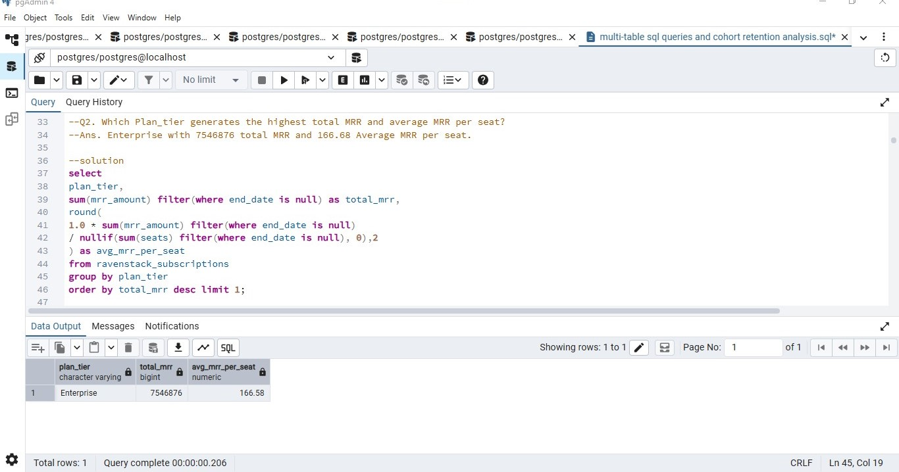
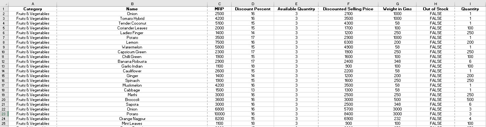
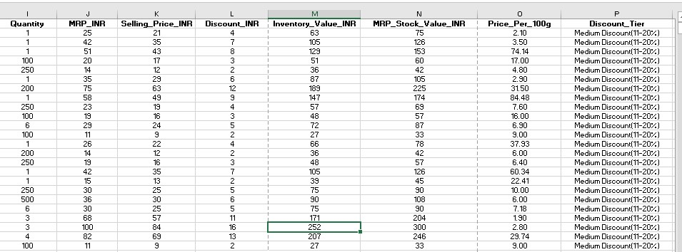
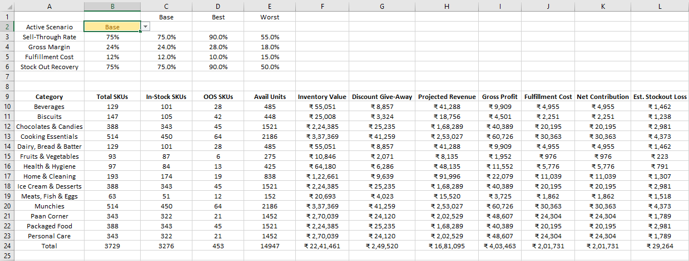
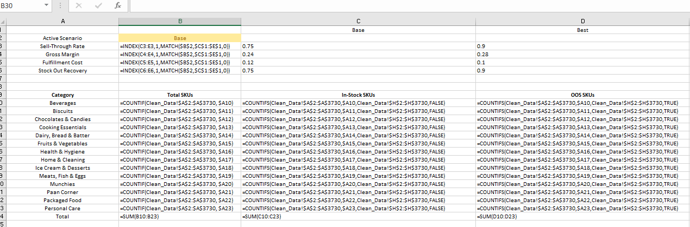
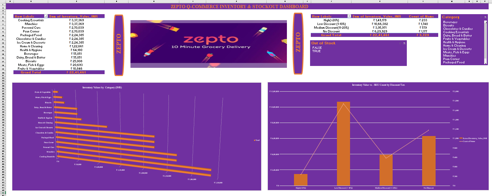

# Arrowstack Technologies — Data Analytics Internship Portfolio

This repository documents my end-to-end work for the **Arrowstack Technologies Data Analytics Internship**, covering multi-table SQL queries & cohort retention analysis and Advanced Excel Financial Modeling & Pivot Dashboard.

---

## Repository Structure

```text
arrowstack_data_analytics_internship/
├── Datasets/
├── Excel_task/
├── Screenshots/
├── multi-table sql queries and cohort...
└── README.md
```

---

## Project 1: Multi-Table SQL Queries & Cohort Retention Analysis

### Overview
Analyzed subscription lifecycle, revenue retention, and monthly recurring revenue (MRR) trends using multi-table SQL queries and cohort tracking across relational datasets.

### Key Highlights
* **Cohort & Retention Tracking:** Evaluated user/account retention across relative time periods to measure stickiness and churn patterns over time.
* **MRR & Revenue Analysis:** Aggregated recurring revenue metrics to identify growth drivers and retention behavior.

### Visual Proof
* **Monthly Recurring Revenue (MRR) Analysis:**



* **Relative Month Index Cohort View:**


---

## Project 2: Zepto Q-Commerce — Excel Financial Modeling & Pivot Dashboard

### Overview
Built an end-to-end inventory and financial scenario model in Microsoft Excel (`Clean_Data`, `Financial_Model`, and `Pivot_Dashboard`) across **3,729 SKUs** in **14 product categories**, pairing cleaned operational data with dynamic scenario assumptions (`Base`, `Best`, `Worst`) and an interactive Pivot dashboard.

### Workbook Architecture
1. **`Clean_Data` (Columns A–P, 3,729 SKUs):**
   * **Base & Operational Fields (`A–I`):** `Category`, `Name`, `MRP`, `Discount Percent`, `Available Quantity`, `Discounted Selling Price`, `Weight in Gms`, `Out of Stock`, and `Quantity`.
   * **Engineered Financial & Tier Fields (`J–P`):** `MRP_INR`, `Selling_Price_INR`, `Discount_INR`, `Inventory_Value_INR`, `MRP_Stock_Value_INR`, `Price_Per_100g`, and `Discount_Tier` (`No Discount`, `Low Discount (1-10%)`, `Medium Discount(11-20%)`, `High (>20%)`).
2. **`Financial_Model`:**
   * **Scenario Selector (`INDEX` / `MATCH`):** Dynamically switches active model assumptions (`Sell-Through Rate`, `Gross Margin`, `Fulfillment Cost`, and `Stock Out Recovery`) based on the selected scenario (`Base`, `Best`, or `Worst`) in cell `B2`.
   * **Category Summary & Financial Projections (`A9:L24`):** Uses `COUNTIF` and `COUNTIFS` to track `Total SKUs`, `In-Stock SKUs` (`Out of Stock = FALSE`), and `OOS SKUs` (`Out of Stock = TRUE`), alongside `SUMIF` and scenario-driven calculations for `Avail Units`, `Inventory Value`, `Discount Give-Away`, `Projected Revenue`, `Gross Profit`, `Fulfillment Cost`, `Net Contribution`, and `Est. Stockout Loss`.
3. **`Pivot_Dashboard`:**
   * Interactive Pivot tables, slicers (`Category` and `Out of Stock`), horizontal category breakdown chart (`Inventory Value by Category (INR)`), and combo chart (`Inventory Value vs. SKU Count by Discount Tier`).

### Key Metrics Snapshot (`Base` Scenario)
* **Total SKUs Analyzed:** `3,729` (`3,276` In-Stock | `453` Out-of-Stock)
* **Total Available Units:** `14,947`
* **Total Inventory Value:** `₹ 22,41,461`
* **Total Discount Give-Away:** `₹ 2,49,520`
* **Projected Revenue:** `₹ 16,81,095`
* **Gross Profit:** `₹ 4,03,463`
* **Net Contribution:** `₹ 2,01,731`
* **Estimated Stockout Loss:** `₹ 29,264`

### Visual Proof

#### 1. Cleaned & Engineered Dataset (`Clean_Data`)
* **Columns A–I (Base & Stock Attributes):**



* **Columns I–P (Engineered INR Metrics, Unit Pricing & Discount Tiers):**



#### 2. Scenario Financial Model (`Financial_Model`)
* **Calculated Model Output (`Base` Scenario):**



* **Formula Logic (`INDEX`/`MATCH`, `COUNTIF`, `COUNTIFS`, `SUM`):**



#### 3. Interactive Pivot Dashboard (`Pivot_Dashboard`)



---

## Tools & Skills Demonstrated
* **SQL:** Multi-table joins, aggregations, cohort analysis, and MRR tracking
* **Microsoft Excel:** Data cleaning & feature engineering, `INDEX`/`MATCH`, `COUNTIF`, `COUNTIFS`, `SUMIF`, `SUM`, scenario modeling, Pivot Tables, slicers, and dashboard design
