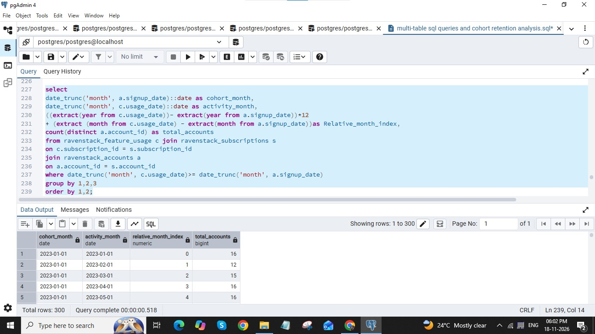

# Multi-Table SQL & Cohort Retention Analysis

## 📌 Project Overview
This project was completed as part of the **Arrowstack Technologies Data Analytics Virtual Internship**. It focuses on extracting, cleaning, and analyzing relational business metrics, customer behavior, and retention patterns using advanced PostgreSQL queries. The dataset models a SaaS platform ("Ravenstack") containing account details, subscription tiers, product feature usage, support tickets, and churn events.

---

## 🛠️ Tech Stack & Tools
* **Database Management System:** PostgreSQL (pgAdmin 4).
* **Querying Techniques:** Multi-table `LEFT JOIN` / `INNER JOIN`, Conditional Aggregations (`FILTER`), Common Table Expressions (CTEs), Window Functions (`DENSE_RANK`, `FIRST_VALUE`), Date Truncation, etc.

---

## 📂 Repository Structure
```text
├── datasets/                  # Raw CSV files (Accounts, Subscriptions, Feature Usage, Support Tickets, Churn)
├── Screenshots/               # Visual proof of SQL query executions and outputs
├── multi-table sql queries and cohort retention analysis.sql  # Complete PostgreSQL query script
└── README.md                  # Project documentation and summary of insights



